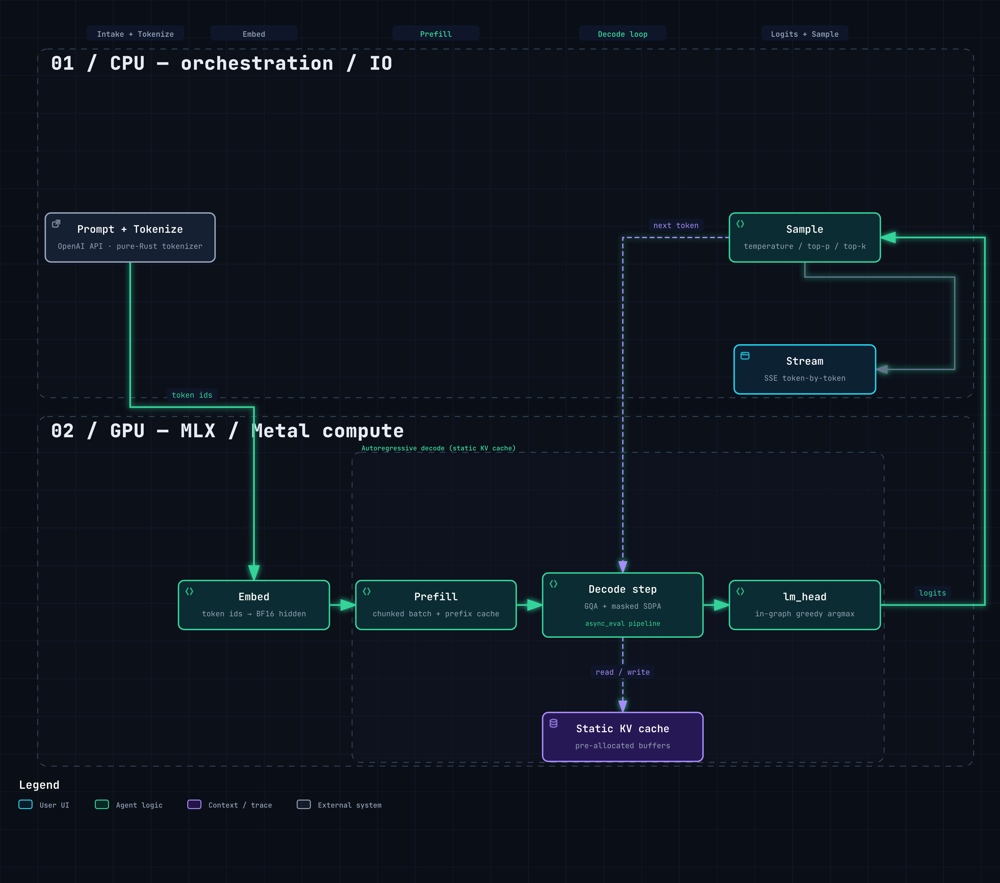

# engine-mlx

[](#license) [](https://www.rust-lang.org) [](https://github.com/ml-explore/mlx) [](#quick-start) [](CHANGELOG.md)

**A small, honest LLM inference engine for Apple Silicon — token-exact with `mlx_lm`, OpenAI-compatible, fully local.**

`#Rust` · `#MLX` · `#AppleSilicon` · `#LLM` · `#LocalFirst` · `#OpenAI-compatible` · `#Quantization`

[](docs/engine-mlx-flow.png)

**engine-mlx** is a small, honest LLM inference engine for **Apple Silicon**,
written in **Rust** on top of Apple's [MLX](https://github.com/ml-explore/mlx)
framework (via its C API, `mlx-c`). It loads a quantized model, runs prefill and
decode, and serves an **OpenAI-compatible HTTP API** — so any OpenAI client,
agent, or harness can talk to it locally. It generates text that matches
`mlx_lm` **token-for-token** at temperature 0, and ships with a **reproducible
benchmark** so its performance can be verified, not trusted.

- **Repo:** `dangranaz/engine-mlx`
- **Stack:** Rust on Apple MLX (`mlx-c`) → Metal
- **API:** OpenAI-compatible HTTP — `/v1/chat/completions`, SSE streaming
- **Parity:** token-exact vs `mlx_lm` at temperature 0 (verified by tests)

> [!IMPORTANT]
> **Correctness first, honesty always.** engine-mlx is a reference-quality
> baseline: readable, auditable, and token-exact with `mlx_lm`. It is **not** a
> speed record — absolute throughput still trails `mlx_lm`, and the gap is
> kernel efficiency, not graph overhead. Everything runs **locally** on your
> Mac: private, offline, OpenAI-compatible.

---

## Features

- **Apple Silicon native** — built on Apple MLX via `mlx-c`, links Metal directly.
- **OpenAI-compatible** — `/v1/chat/completions`, `/v1/models`, `/health`, SSE streaming.
- **Token-exact** — matches `mlx_lm` token-for-token at temperature 0 (verified by tests).
- **Mixed per-weight quantization** — per-tensor `group_size`/`bits` (e.g. 8-bit
  attention + 4-bit MLP in the same model), read from the model config.
- **Grouped RMSNorm** — multi-group normalization alongside the standard fused path.
- **Thinking models** — renders the model's own chat template, including a
  reasoning channel, and the benchmark discriminators tolerate a reasoning preamble.
- **Static KV cache by default** — pre-allocated buffers + masked SDPA, so decode
  throughput doesn't collapse as context grows.
- **BF16 pipeline**, pipelined `async_eval`, in-graph greedy argmax.
- **Pure-Rust multi-format tokenizer** (BPE / WordPiece / Unigram), HF-parity tested.
- **Stable under sustained load** — each request rebuilds fresh state; no buffer
  accumulation across requests.
- **Portable core** — the non-MLX crates build and test on Linux (stub mode) for CI.

---

## Requirements

- **macOS on Apple Silicon** (M-series).
- The MLX C API: `brew install mlx-c` — supported mlx-c package range is
  **`>=0.7.0, <0.9.0`** (`0.7.x` and `0.8.x`). The build `--features mlx` reads
  the mlx-c version from `MLXCConfigVersion.cmake` and **fails with an explicit
  message** if it falls outside that range. This is the only place mlx-c is pinned.
- Rust (`cargo`) to build.

---

## Quick start

```sh
# 1. install the MLX C API
brew install mlx-c

# 2. build with the `mlx` feature (the build script auto-detects the Homebrew
#    MLX prefixes — no manual paths needed)
cargo build --release --features mlx

# 3. run the server on a model directory (must contain config.json)
cargo run --release --features mlx -p engine-mlx-serve -- \
  --model /path/to/Qwen3-1.7B-MLX-4bit
#    → serves http://127.0.0.1:11435
```

Then call it like any OpenAI endpoint:

```sh
curl -s http://127.0.0.1:11435/v1/chat/completions \
  -H 'Content-Type: application/json' \
  -d '{
    "model": "Qwen3-1.7B-MLX-4bit",
    "messages": [{"role": "user", "content": "Explain quantum computing in one sentence."}],
    "max_tokens": 64,
    "temperature": 0
  }'
```

Prefer scripts? [dangranaz/prj-scripts](https://github.com/dangranaz/prj-scripts)
has friendly `start-server.sh` / `stop-server.sh` wrappers.

---

## Getting a model

engine-mlx does **not** ship model weights — you download an MLX-format Qwen3
model yourself. By default the engine looks for models under **`~/models`**, in
the HuggingFace-style layout:

```
~/models/<org>/<model-name>/
    ├── config.json          # required
    ├── model.safetensors
    └── tokenizer.json
```

For example, `~/models/lmstudio-community/Qwen3-1.7B-MLX-4bit/`.

Download one (e.g. with the Hugging Face CLI):

```sh
# install once:  pip install huggingface_hub
huggingface-cli download lmstudio-community/Qwen3-1.7B-MLX-4bit \
  --local-dir ~/models/lmstudio-community/Qwen3-1.7B-MLX-4bit
```

You can put models anywhere and pass an absolute path, or keep them under
`~/models` and refer to them by `<org>/<name>` (or a bare unique name). Override
the search root with the `ENGINE_MLX_MODELS_DIR` environment variable.

### Starting the server with the scripts

Two ready-made options — both bring up the OpenAI-compatible server on
`http://127.0.0.1:11435`:

**End-user scripts** ([prj-scripts](https://github.com/dangranaz/prj-scripts)) —
simplest:

```sh
./engine-mlx/start-server.sh ~/models/lmstudio-community/Qwen3-1.7B-MLX-4bit
./engine-mlx/stop-server.sh
```

**Repo scripts** (`scripts/` in this repo) — resolve models by name under
`~/models`, list/scan them, tail logs:

```sh
scripts/server.sh models list                     # what's under ~/models
scripts/server.sh start Qwen3-1.7B-MLX-4bit --release
scripts/server.sh status
scripts/server.sh stop
```

---

## Workspace layout

| Crate        | Role                                                        |
|--------------|-------------------------------------------------------------|
| `mlx-ffi`    | MLX-C bindings (bindgen) + `MlxCtx` real ops / Metal link    |
| `ops`        | Atomic ops (quantized matmul, RoPE, SDPA, RMSNorm, …)        |
| `attention`  | Attention layers (GQA, sliding window, gated)               |
| `kvcache`    | KV cache backends (concat, fp8, rotating)                   |
| `prefill`    | Prefill pipeline (prefix cache + chunked batch prefill)     |
| `serve`      | Qwen3 engine + model loader + OpenAI HTTP server            |
| `modelplan`  | Model introspection → `ModelManifest` (vendored)            |
| `tokenizer`  | Pure-Rust multi-format tokenizer, HF-parity (vendored)      |

Without the `mlx` feature the workspace builds against stubs — useful for CI on
non-Apple machines and for compiling the non-MLX crates.

---

## Documentation

Product documentation lives in **[`docs/`](./docs/)**:

- **[Supported models](./docs/models.md)** — verified model families and
  quantization formats (Qwen3, K2-Horizon mixed-quant).
- **[Benchmarks](./docs/benchmarks.md)** — generation speed, sustained-load
  stability, length-ramp behavior, and how to reproduce them.
- **[Architecture](./docs/architecture.md)** — request flow (load → prefill →
  decode → serve) and the crate layout.

---

## Supported models

engine-mlx targets dense transformers in MLX format — the **Qwen3** family and
**K2-Horizon** (a thinking model with mixed quantization). These are the
configurations that are actually exercised and verified:

| Model            | Quantization                     | Status                                         |
|------------------|----------------------------------|------------------------------------------------|
| Qwen3-0.6B       | 4-bit (MLX)                      | ✅ verified, token-exact vs `mlx_lm`           |
| Qwen3-1.7B       | 4-bit (MLX)                      | ✅ verified, token-exact vs `mlx_lm`           |
| Qwen3-1.7B       | 8-bit (MLX)                      | ✅ verified (4/8-bit read from config)         |
| K2-Horizon-3.7B  | mixed 8-bit attn / 4-bit MLP     | ✅ verified, token-exact vs `k2_horizon.py`    |

**K2-Horizon-3.7B-4bit** exercises the new capabilities in this version: mixed
per-weight quantization (qkv 8-bit/group-64, gate/up 4-bit/group-32), grouped
RMSNorm (2 groups), nested `rope_theta`, and a *thinking* chat template that
emits reasoning before the final answer. It is token-exact against its reference
implementation (34/34 tokens) and stable under sustained load (no leak, no
output degradation across 30+ requests).

The loader reads `group_size` / `bits` per tensor from the model config, so other
MLX checkpoints of the same shapes should load; only the models above are tested.

---

## Benchmarks — generation speed

Real, reproducible numbers live in
[dangranaz/prj-bench](https://github.com/dangranaz/prj-bench): the exact
harness, the exact tests, and reference results you can re-run on your own
hardware. Measured on a **MacBook Air M1, 16 GB**, greedy (temperature 0):

| Model               | Generation speed | Sustained (20×) | Length ramp 128→1024 |
|---------------------|------------------|-----------------|----------------------|
| Qwen3-1.7B-MLX-4bit | ~34–41 t/s       | ~6% degradation | ~16% drop            |
| Qwen3-0.6B-MLX-4bit | ~55–57 t/s       | —               | —                    |
| K2-Horizon-3.7B-4bit | ~7–8 t/s¹       | ~12% degradation | ~11% drop           |

- **Generation speed** = decode tokens/second.
- **Sustained** = 20 identical requests; throughput must not drift (leak guard).
- **Length ramp** = throughput across 128 / 512 / 1024 output tokens (KV scaling).
- ¹ K2-Horizon is a 3.7B thinking model and its decode is **not yet optimized**:
  ~7–8 t/s today is honest and stable, not a ceiling. The gap is the engine's
  static-decode path (per-token synchronization, full-capacity attention), not
  the model — a speedup is tracked as dedicated follow-up work. Correctness and
  stability are unaffected.

`mlx_lm` is still faster in absolute throughput; the gap is kernel efficiency,
not graph overhead. Numbers depend on your chip and thermal state — re-run the
harness to get yours.

---

## Honest limitations

- Not a speed record — a correctness-first baseline.
- No long-context disk offload: very large contexts beyond RAM are out of scope.
- The MLX-C C API doesn't expose the graph fusions of Python `mx.compile`, which
  caps some optimizations.

---

## Why Rust

Rust was a deliberate choice, for **robustness**: strong typing, no garbage
collector, explicit memory ownership, and errors you handle rather than discover
at runtime — the properties you want in a systems component like an inference
engine. The honest trade-off: for MLX the **Rust ecosystem is still young**
compared to Python — bindings are thinner and examples fewer — so more has to be
built and verified from the primitives. That's a cost, but the robustness (and
the discipline it forces) is worth it here.

---

## How this was built

> The full story — the purpose, the method, the hardware constraint, and the bug
> that proves the point — is in **[STORY.md](./STORY.md)**.

engine-mlx was built primarily by **orchestrating AI coding agents** against
objective, verifiable acceptance tests — token-exact parity with `mlx_lm`,
reproducible benchmarks — rather than typing every line by hand. The engineering
that mattered was choosing the right targets, verifying relentlessly, and
reporting results (limitations included) honestly.

**On a tight hardware budget.** All of this — development *and* the benchmarks —
was done on a **MacBook Air M1 with 16 GB of unified memory**. That constraint
is part of the point: it shapes what "works" means (the sustained-load fix, for
example, was about keeping a live-buffer count flat on limited memory), and it
shows the engine runs on modest, widely-available hardware.

**Tools.** I work mainly with **OpenCode** and **Pi**, using the free AI models
available in OpenCode and the free models offered by **NVIDIA** — no paid model
subscriptions. The leverage comes from steering these agents well and holding
them to a hard bar for "done," not from expensive tooling.

---

## ⭐ Support the project

If engine-mlx is useful to you — or if you value seeing a working, honestly
benchmarked inference engine built on a modest machine — please **give the
repository a star** and share it. It's the simplest way to help the project
reach other developers. Feedback, issues, and suggestions are very welcome.

---

## Contributors

Built and maintained by [**@dangranaz**](https://github.com/dangranaz).

---

## License

Released under the **MIT license** — see [LICENSE](./LICENSE).

**Free for personal use**: use it, study it, and share it for your own projects
at no cost. MIT also allows commercial use and redistribution under the same
terms.
